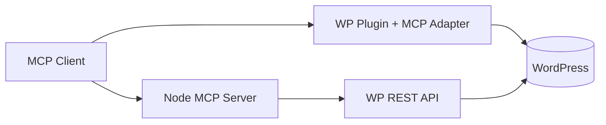

# Lazy WordPress MCP

Production-ready **Model Context Protocol (MCP)** integration for WordPress content operations.

Choose one path:

| Path | When to use |
|------|-------------|
| **Plugin** (`plugin/wp-mcp-content`) | WordPress **6.9+** with [Abilities API](https://developer.wordpress.org/reference/functions/wp_register_ability/) + [MCP Adapter](https://github.com/WordPress/mcp-adapter) |
| **Standalone** (`standalone/`) | Any WordPress with REST API + Application Passwords; runs as Node MCP server (stdio or Streamable HTTP) |



## Features

- Site info & environment
- Posts & pages: list, get, create (draft default), update, delete, status change
- Media: list, get, upload, alt text
- Categories & tags
- Comments: list, approve, reply, trash/spam
- Users: list (limited), current user
- Settings: safe read; write gated off by default
- Plugins/themes: read-only list
- SEO: Yoast / Rank Math when present
- WooCommerce: products & orders read (writes gated)
- Allow-list, rate limiting, `confirm: true` on destructive ops
- Resources: recent posts, site health summary
- Prompts: draft-post, moderate-comments, seo-audit

## Install — Plugin

1. WordPress **6.9+**, PHP **8.1+**.
2. Install **MCP Adapter** (`wordpress/mcp-adapter`) as a plugin, **or** run `composer install` inside `plugin/wp-mcp-content` (suggested dependency).
3. Copy `plugin/wp-mcp-content` → `wp-content/plugins/wp-mcp-content`.
4. Activate **WordPress MCP Content Bridge**.
5. Settings → **MCP Content** — configure allow-list, rate limit, write toggles.
6. Create an Application Password for a least-privilege user.

**HTTP endpoint (custom server):**

```
https://your-site/wp-json/wp-mcp-content/mcp
```

**Default adapter server (core abilities discovery):**

```
https://your-site/wp-json/mcp/mcp-adapter-default-server
```

**WP-CLI STDIO:**

```bash
wp mcp-adapter serve --server=wp-mcp-content --user=mcp-editor
```

**Remote proxy:**

```bash
export WP_API_URL=https://your-site
export WP_API_USERNAME=mcp-editor
export WP_API_PASSWORD='xxxx xxxx xxxx xxxx'
npx -y @automattic/mcp-wordpress-remote@latest
```

## Install — Standalone

```bash
cd standalone
npm install
cp .env.example .env   # edit WP_BASE_URL, WP_USERNAME, WP_APPLICATION_PASSWORD
npm run build
npm run start:stdio    # or start:http
```

Env vars: see [`standalone/README.md`](standalone/README.md).

## Auth

See [`docs/AUTH.md`](docs/AUTH.md). Application Passwords need **HTTPS** (except localhost). WordPress.com uses OAuth 2.1 separately (scaffolding in standalone).

## Client configs

Examples for Claude Desktop, Cursor, VS Code, ChatGPT, and generics:

- [`examples/configs/`](examples/configs/)
- Guide: [`docs/CLIENTS.md`](docs/CLIENTS.md)

## Tools

Summary: `wp_site_*`, `wp_posts_*`, `wp_pages_*`, `wp_media_*`, `wp_taxonomies_*`, `wp_comments_*`, `wp_users_*`, `wp_settings_*`, `wp_plugins_themes_list`, `wp_seo_*`, `wp_woo_*`.

Full JSON Schema + caps: [`docs/TOOLS.md`](docs/TOOLS.md).

## Security recommendations

- Dedicated MCP user, least privilege
- Tool allow-list; disable writes on public HTTP
- Rate limit + reverse-proxy TLS + WAF
- Never commit Application Passwords; rotate regularly
- Require `confirm: true` for delete / publish / spam

Details: [`SECURITY.md`](SECURITY.md), [`docs/DEPLOYMENT.md`](docs/DEPLOYMENT.md).

## Architecture

[`docs/ARCHITECTURE.md`](docs/ARCHITECTURE.md)

## Troubleshooting

| Issue | Fix |
|-------|-----|
| Admin notice: MCP Adapter missing | Install mcp-adapter plugin or `composer install` in plugin dir |
| Abilities not listed | WP 6.9+; category registered; custom server ability list; allow-list |
| 401 on REST | App password, HTTPS, correct username |
| Writes rejected | `MCP_ENABLE_WRITES` / plugin write toggle; `confirm: true` |
| ChatGPT fails | Need Streamable HTTP URL + auth; see CLIENTS.md |
| Multisite wrong site | Pass `blog_id` only if permitted; use site-specific REST URL in standalone |

## Limitations

- Application Passwords require HTTPS except localhost
- Some clients only support remote HTTP (not stdio)
- Multisite: `switch_to_blog` only when `blog_id` passed and user can manage that site
- ChatGPT needs Streamable HTTP + auth
- Woo write tools and page-builder awareness are future work — see [`docs/FUTURE.md`](docs/FUTURE.md)
- SEO tools no-op with a clear message if Yoast/Rank Math absent
- Woo tools no-op if WooCommerce inactive

## License

GPL-2.0-or-later — see [`LICENSE`](LICENSE).
