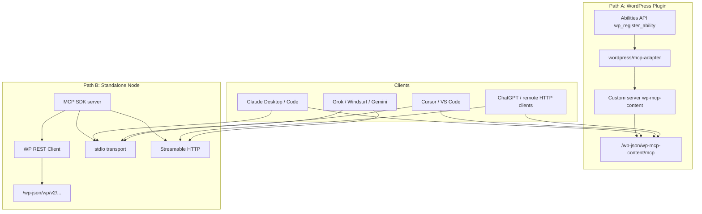

# Architecture

## Overview

This project bridges WordPress content operations to the [Model Context Protocol (MCP)](https://modelcontextprotocol.io/) so AI clients (Claude Desktop, Cursor, VS Code, ChatGPT, Grok, Windsurf, Gemini, etc.) can list/create/update content with least-privilege WordPress capabilities.

Two deployment paths share the same conceptual tool surface:



## Path A — Plugin (`wp-mcp-content`)

1. On `wp_abilities_api_categories_init`, register category `wp-mcp-content`.
2. On `wp_abilities_api_init`, register abilities (tools/resources/prompts) with `input_schema`, `permission_callback`, `execute_callback`.
3. Soft-depend on `WP\MCP\Core\McpAdapter` (Composer vendor **or** separate mcp-adapter plugin).
4. On `mcp_adapter_init`, call `McpAdapter::instance()->create_server(...)` with id `wp-mcp-content`, `HttpTransport`, `ErrorLogMcpErrorHandler`, `NullMcpObservabilityHandler`.
5. Settings (allow-list, rate limit, write toggles) gate which abilities are exposed and whether writes run.
6. Rate limiter stores counters in user-keyed transients.

Default MCP Adapter endpoint (core default server) remains `/wp-json/mcp/mcp-adapter-default-server`. This plugin's custom server is under `/wp-json/wp-mcp-content/mcp`.

STDIO via WP-CLI (when mcp-adapter provides it):

```bash
wp mcp-adapter serve --server=wp-mcp-content --user=<id-or-login>
```

Remote proxy:

```bash
npx -y @automattic/mcp-wordpress-remote@latest
# Env: WP_API_URL, WP_API_USERNAME, WP_API_PASSWORD
```

## Path B — Standalone (`standalone/`)

1. Node process loads config from env (`.env` optional).
2. Authenticates to WordPress with Application Password (Basic) or OAuth scaffolding.
3. Registers MCP tools with Zod validation mirroring the plugin surface.
4. Transport: **stdio** (default) or **Streamable HTTP** (Express) with optional Bearer token and session headers.

## Security layers

| Layer | Plugin | Standalone |
|-------|--------|------------|
| Auth | WP Application Passwords / logged-in user | Basic App Password / Bearer / OAuth stubs |
| Caps | `permission_callback` + WP caps | Same caps enforced by WP REST |
| Allow-list | Settings checkboxes | `MCP_TOOL_ALLOWLIST` |
| Writes | Toggle + confirm | `MCP_ENABLE_WRITES` + confirm |
| Rate limit | Transient by user | In-memory / sliding window |
| Network | WP REST ACL | Only `WP_BASE_URL`; CORS locked |

## Multisite

If `blog_id` is passed and the user can manage that site, the plugin may `switch_to_blog` / `restore_current_blog`. Standalone should target the correct site REST URL. See Limitations in README.
